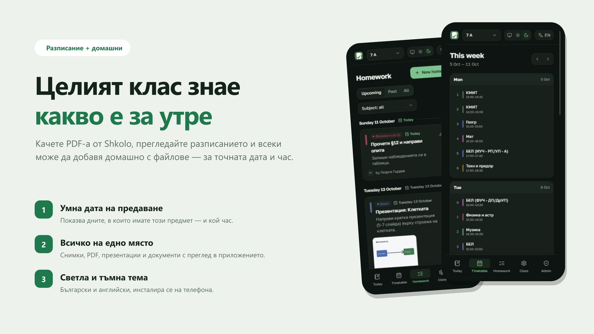
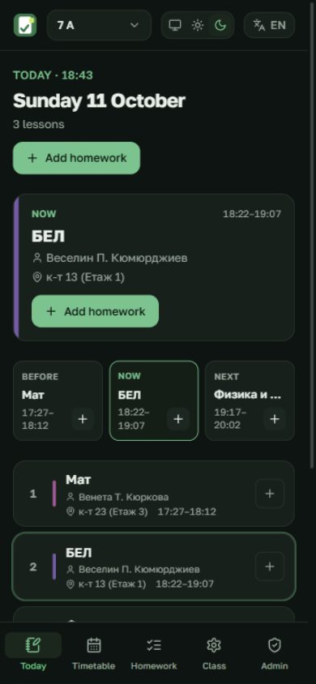
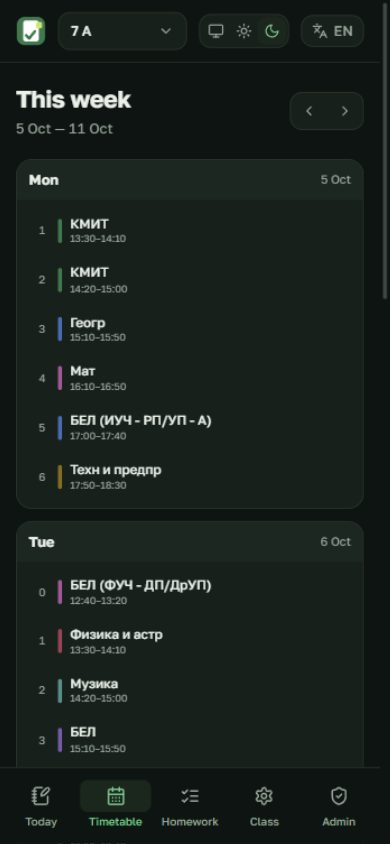
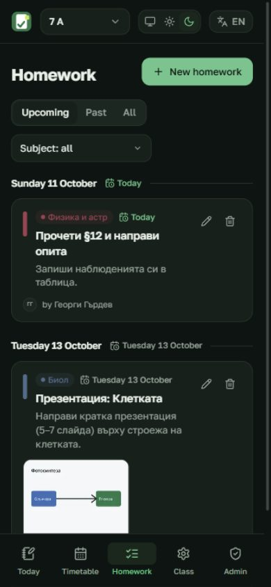
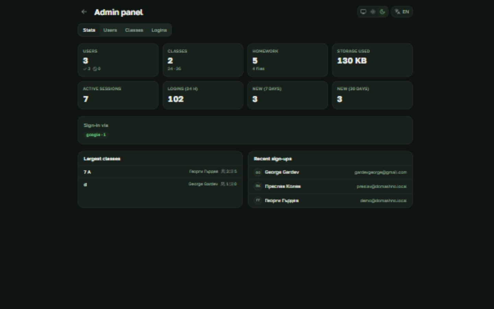

# Домашно

Timetable + homework board for a school class. Import the weekly timetable from a
**Shkolo PDF**, then let classmates post homework with files. Installs as an app (PWA).

- **Shkolo PDF import** — reads the timetable automatically, you review and fix it, then save.
- **Today, by the clock** — shows the lesson that just ended, the one happening now, and the next one, each with one-tap homework.
- **Homework** with due dates, notes, and file uploads (photos, PDF, presentations, documents), editable and deletable.
- **Classes** with invite codes and per-subject permissions for who may post homework.
- **Admin panel** (`/admin`, gated by `ADMIN_EMAIL` in `.env`) — stats, user management, bans, login fingerprints, and per-class feature flags (upload limit, freeze, official/featured).
- **Sign in** with Google / GitHub, or an email code.
- Light & dark theme, Bulgarian & English.

## Setup

Requirements: **Node 20+** (22 recommended) and npm.

```bash
git clone https://github.com/gaxolotl/domashno.git
cd domashno
npm install
cp .env.example .env
npm run dev
```

Open **http://localhost:5173**.

The only thing you must set to start:

```ini
SESSION_SECRET=any-long-random-string   # node -e "console.log(crypto.randomUUID()+crypto.randomUUID())"
ENABLE_DEV_LOGIN=1                       # local convenience: sign in without email
```

To enable real sign-in, fill in `.env` (see `.env.example`):

| Setting | Purpose |
|---|---|
| `GOOGLE_CLIENT_ID` / `GOOGLE_CLIENT_SECRET` | "Continue with Google" (callback: `/api/auth/google/callback`) |
| `GITHUB_CLIENT_ID` / `GITHUB_CLIENT_SECRET` | "Continue with GitHub" (callback: `/api/auth/github/callback`) |
| `RESEND_API_KEY` + `EMAIL_FROM` | Email sign-in codes/links via [Resend](https://resend.com) (or use `SMTP_*`) |

Without an email provider, verification codes are printed to the server log.

### Production

See **[DEPLOY.md](./DEPLOY.md)** for a step-by-step VPS setup with a custom domain
and automatic HTTPS. Build with `npm run build`, run with `npm start`.

## How to use

1. **Sign in.**
2. **Create a class** (or join one with a 6-character invite code).
3. **Edit (timetable)** → *Choose PDF* → pick your Shkolo PDF → check the result → **Save**.
   (Or use the sample 7А timetable, or build it by hand.)
4. **Class** → copy the **invite code** and share it with your classmates.
5. **Today** → tap the **+** next to a lesson to add homework; attach files; **Save**.
6. **Class** → choose who may post homework: *everyone*, or *chosen people per subject*.

## Screenshots



| Днес (Now) | Разписание | Домашни |
|---|---|---|
|  |  |  |

Admin panel (stats, users, bans, login fingerprints, class features):



Branding sources live in [`web/branding/`](web/branding/README.md).

## Project layout

```
server/   Node + Express + SQLite API, Shkolo PDF parser, email
web/      React + Vite + Tailwind PWA
deploy/   nginx / Caddy config + systemd unit for production
```

## Scripts

| Command | What it does |
|---|---|
| `npm run dev` | API on :8787 + web on :5173 |
| `npm run build` | Build the web app into `web/dist` (the server serves it) |
| `npm start` | Run the server against the built app |
| `node server/scripts/reset-data.mjs` | Wipe the database and uploads |
| `node server/scripts/test-import.mjs file.pdf` | Parse a Shkolo PDF from the CLI |

## License

[GPL-3.0-or-later](./LICENSE) © gaxolotl
